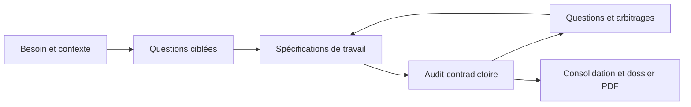

# Spécifier un projet

[](https://github.com/rangornrar/specifier-projet/actions/workflows/validate.yml)
[](LICENSE)


**Transformer une idée de logiciel en spécifications fonctionnelles et techniques, par questions progressives et revue contradictoire.**

Ce skill accompagne le cadrage d'un petit projet : il clarifie le besoin, confronte les exigences à plusieurs perspectives, reprend les points ouverts et produit un dossier PDF lorsque l'environnement le permet.

## Démarrer

Une fois le skill installé, lancez par exemple :

```text
Utilise $specifier-projet pour cadrer une application locale de suivi de prêts
de matériel. Je travaille seul sous Windows. Commence par les questions
qui changent le périmètre et attends mes réponses avant de poursuivre.
```

Vous pouvez aussi fournir un cahier des charges existant pour le faire auditer ou reprendre une version de travail. Voir le [guide d'utilisation](docs/UTILISATION.md) et les [exemples de demandes](examples/DEMANDES.md).

## Ce que le skill apporte

- Un entretien par lots de une à trois questions prioritaires.
- Un périmètre V1 et des exclusions explicites.
- Des exigences identifiées, reliées à des critères de recette observables.
- Une revue sous huit regards : optimiste, contradicteur, chef de projet, développeur, architecte, utilisateur/métier, qualité/exploitation et directeur de synthèse.
- Des choix techniques argumentés : plateforme, OS, architecture, langages et méthode de réalisation.
- Un dossier PDF versionné, une source éditable et un état de reprise, selon les outils disponibles.

Les regards sont des perspectives d'analyse de l'IA. Les hypothèses, propositions et décisions de l'utilisateur restent distinguées dans le dossier.



## Installer

### Avec le skill-installer de Codex

Demandez à Codex :

```text
Utilise $skill-installer pour installer le skill du dépôt
https://github.com/rangornrar/specifier-projet ; SKILL.md est à la racine.
```

L'accès au dépôt privé nécessite un compte autorisé. Ne collez pas de jeton d'accès dans une conversation ou une issue.

### Installation locale avec Git

Pour une installation personnelle, clonez le dépôt dans le répertoire de découverte des skills de Codex.

Windows / PowerShell :

```powershell
$skillsDirectory = Join-Path $env:USERPROFILE '.agents\skills'
New-Item -ItemType Directory -Force -Path $skillsDirectory | Out-Null
git clone https://github.com/rangornrar/specifier-projet.git (Join-Path $skillsDirectory 'specifier-projet')
```

macOS / Linux :

```sh
mkdir -p "$HOME/.agents/skills"
git clone https://github.com/rangornrar/specifier-projet.git "$HOME/.agents/skills/specifier-projet"
```

Si le dossier existe déjà, mettez sa copie à jour avec Git au lieu de relancer le clonage. Pour un usage limité à un projet, placez le dossier `specifier-projet` dans son répertoire `.agents/skills/`.

Codex détecte les changements de skills ; si le skill n'apparaît pas, redémarrez Codex. Dans la CLI ou l'extension IDE, mentionnez `$specifier-projet` ; dans une interface proposant un sélecteur, sélectionnez « Spécifier un projet ».

Les emplacements et modes de découverte suivent la [documentation officielle OpenAI sur les skills](https://learn.chatgpt.com/docs/build-skills). Les autres clients peuvent demander une méthode d'import différente.

## Prérequis et limites

Le cœur du skill est constitué d'instructions Markdown et de métadonnées YAML : aucun serveur ni clé API propre à ce dépôt n'est nécessaire. L'exécution dépend du client et des outils auxquels l'assistant a accès.

Pour produire le dossier, l'environnement doit fournir un skill PDF, des outils de génération et de rendu, ainsi qu'une sauvegarde persistante. Le skill demande d'inspecter les pages avant livraison. Il doit signaler un échec de génération ou une capacité absente.

Le skill sert au cadrage et à la spécification. Les arbitrages métier appartiennent à l'utilisateur. Les coûts, obligations et capacités techniques actuelles doivent être vérifiés auprès de sources adaptées. Aucun projet ni PDF de démonstration n'est fabriqué sans besoin décrit.

## Ressources du dépôt

| Ressource | Rôle |
| --- | --- |
| [SKILL.md](SKILL.md) | Instructions de référence du skill |
| [agents/openai.yaml](agents/openai.yaml) | Nom affiché, invite et politique d'invocation |
| [Domaines de questions](references/domaines.md) | Aide pour préparer l'entretien et identifier les lacunes |
| [Plan du dossier](references/plan-dossier.md) | Structure et contrôles du livrable PDF |
| [Guide d'utilisation](docs/UTILISATION.md) | Préparer le contexte, itérer et reprendre le travail |
| [Exemples](examples/DEMANDES.md) | Demandes de démarrage, d'audit et de reprise |
| [Validation et recette](docs/VALIDATION.md) | Contrôles automatiques et scénarios manuels |
| [Contribuer](CONTRIBUTING.md) | Proposer et vérifier une modification |
| [Historique](CHANGELOG.md) | Évolutions du dépôt |

## Développer et contribuer

Python 3.10 ou plus récent est nécessaire uniquement pour les contrôles du dépôt :

```sh
python -m pip install -r requirements-dev.txt
python scripts/validate_repository.py
```

GitHub Actions exécute les mêmes contrôles sur les pushes et les pull requests. Les [modèles d'issues](https://github.com/rangornrar/specifier-projet/issues/new/choose) permettent de signaler un problème ou de proposer une amélioration. Utilisez des exemples fictifs ou anonymisés.

## Licence

Ce projet est distribué sous [licence MIT](LICENSE).
